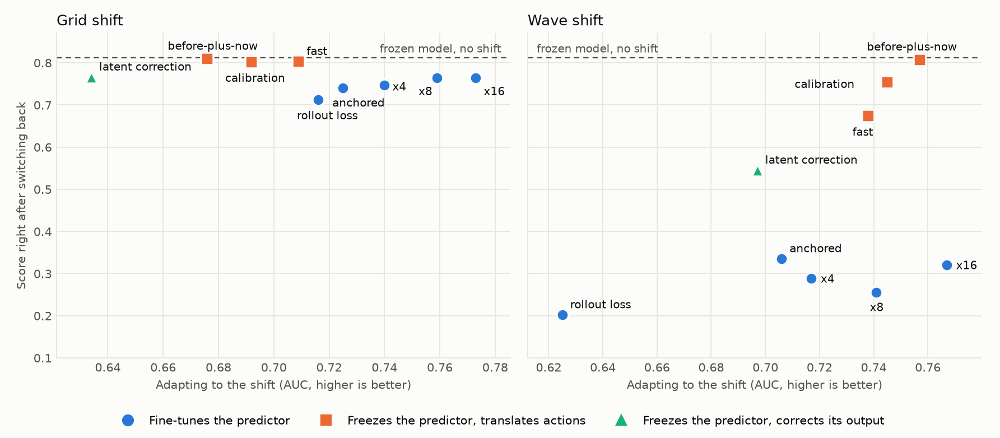
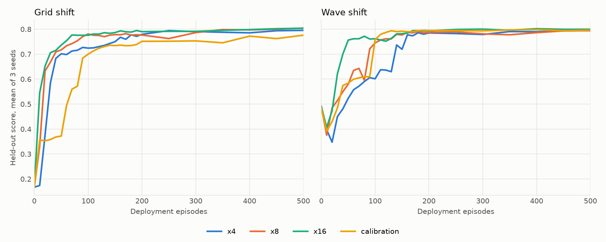
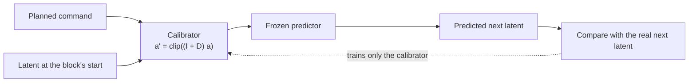

# Adapting vs. remembering in latent world models

An independent reproduction and extension of
[JEPA-TTT](https://arxiv.org/abs/2610.00722) on the Two-Room task, using the public
[LeWorldModel](https://github.com/lucas-maes/le-wm) checkpoint. I found no official JEPA-TTT code
as of November 2026, so this implements the method from the paper.

**The question:** when a world's dynamics change, can a pretrained world model keep planning well by
learning during deployment, and what does it lose by doing so?

**The short answer, on this one task with 3 seeds:** yes, it can adapt. More frequent updates speed
that up a lot. On the wave shift, fine-tuning also forgets the old world, while keeping the predictor
frozen and learning a small action translator barely forgets. That translator is usually, though not
always, slower to adapt than the fastest fine-tuning.



## Key findings

1. **With more updates, persistent adaptation scored above JEPA-TTT's published Two-Room results.** At
   x16, AUC was 7% higher than the paper's on grid (0.773 vs 0.725) and 5% higher on wave (0.767 vs
   0.728). Compared with its own frozen model, x16 improved best score by 381% on grid and 66% on wave,
   against the paper's 279% and 43%. These use different checkpoints, and part of my percentage gain
   comes from a lower frozen baseline. At the paper's own update rate, I scored below it.
   [See the comparison](#comparison-with-jepa-ttt).
2. **More updates were the cheapest large gain.** Using the same data and learning rate, going from
   x4 to x16 raised AUC from 0.740 to 0.773 on grid and from 0.717 to 0.767 on wave. It also cut the
   episodes to a sustained 90% of the no-shift score from 130 and 160 to 50. Planning kept improving
   through x16, but more updates may be nearing a limit: from x8 to x16, prediction error stayed flat
   on grid and rose on wave (0.255 to 0.332).
3. **On wave, adapting and remembering pull apart.** Right after the world silently switches back, x16
   scores 0.320 and `action_calibration` scores 0.753, against 0.812 for the frozen model. On grid the
   gap is much smaller (0.764 vs 0.802).
4. **`calibration_before_now` was the closest to both on wave.** It keeps the frozen model and a
   calibrated version, and plans with whichever predicted recent steps better. On wave, it nearly
   matches x16 on adaptation (AUC 0.757 vs 0.767) and scores 0.807 right after switching back. On grid,
   it adapts much more slowly than x16 (0.676 vs 0.773). Its pass is partly by construction, as
   [explained below](#limitations).
5. **The paper partly reproduced.** The adaptive arms' best grid scores matched within 0.02, though
   `persistent_replay`'s grid AUC was lower (0.651 vs 0.725). On wave, the paper's update rate reached
   a best score of 0.646 against the paper's 0.799, failing a check I set in advance. x4 reached 0.799.
   Update rate isn't the whole story: `persistent_local` makes more updates, yet reached only 0.608.
6. **In this comparison, prediction error didn't track planning.** In the old world, the calibrator's
   rollout error (1.84–1.88) is worse than x16's (1.56–1.68), yet it plans far better on wave right
   after the switch. I don't have a tested explanation yet.
7. **Several ideas failed their rules.** `action_calibration` failed against x4 and x16 on both shifts.
   A V-JEPA 2.1-style rollout loss slowed wave adaptation from 160 to 400 episodes. Latent correction
   was the weakest adapter on grid, and anchoring gave no adaptation gain.

## Results

AUC is the held-out score across the adaptation run, so higher means better and earlier. "Episodes"
is when the mean score reaches and holds 90% of the no-shift score (0.73). "Back" columns are scores
immediately after, and 50 episodes after, the world silently returns to its original dynamics. All
values are means of 3 seeds, except the single frozen baseline.

<!-- results-table -->
| Arm | Grid AUC | Episodes | Back 0 | Back 50 | Wave AUC | Episodes | Back 0 | Back 50 |
|---|---|---|---|---|---|---|---|---|
| `frozen` | 0.167 | never | - | - | 0.483 | never | - | - |
| `persistent_replay_x4` | 0.740 | 130 | 0.747 | 0.759 | 0.717 | 160 | 0.288 | 0.511 |
| `persistent_replay_x8` | 0.759 | 60 | 0.764 | 0.765 | 0.741 | 100 | 0.255 | 0.573 |
| `persistent_replay_x16` | **0.773** | **50** | 0.764 | 0.777 | **0.767** | **50** | 0.320 | 0.684 |
| `action_calibration` | 0.692 | 140 | 0.802 | 0.804 | 0.745 | 100 | 0.753 | 0.808 |
| `calibration_before_now` | 0.676 | 190 | **0.809** | **0.812** | 0.757 | 70 | **0.807** | **0.812** |
| `calibration_fast` | 0.709 | 100 | 0.803 | 0.804 | 0.738 | 90 | 0.674 | 0.801 |
| `latent_correction` | 0.634 | 350 | 0.766 | 0.778 | 0.697 | 250 | 0.545 | 0.769 |
| `rollout_loss_x4` | 0.716 | 130 | 0.713 | 0.700 | 0.625 | 400 | 0.202 | 0.423 |
| `anchored_x4` | 0.725 | 130 | 0.740 | 0.752 | 0.706 | 160 | 0.335 | 0.757 |
<!-- /results-table -->

A test checks this table against [`results/summary.csv`](results/summary.csv), which is generated
from the saved reports. The frozen model scores 0.812 with no shift.

**Seeds disagree, so read the means with care.** For the arms with raw logs:

| Arm | Grid AUC by seed | Wave AUC by seed | Wave Back 0 by seed |
|---|---|---|---|
| `persistent_replay_x4` | 0.745, 0.739, 0.736 | 0.739, 0.710, 0.702 | 0.467, 0.216, 0.180 |
| `persistent_replay_x8` | 0.750, 0.765, 0.763 | 0.750, 0.730, 0.743 | 0.266, 0.212, 0.288 |
| `persistent_replay_x16` | 0.771, 0.779, 0.768 | 0.766, 0.769, 0.768 | 0.291, 0.254, 0.415 |
| `action_calibration` | 0.647, 0.690, 0.738 | 0.774, 0.774, 0.688 | 0.744, 0.801, 0.716 |

`action_calibration` beat x16 on wave on two of three seeds, and one poor seed lowers its mean. Its
retention advantage on wave holds on every seed.



**Adapting can hurt at first.** On wave, the mean score of every arm in this figure drops below the
frozen model's 0.483 at episode 10, to about 0.38–0.41, before rising. One calibration seed stays
above it. Early updates from very little data seem to make plans worse, which a deployed system would
need to handle.

### Pre-set verdicts

These rules are in the code, written before the results they judge. This repository's git history
starts after the runs, so it can't independently prove the order.

| Idea | Compared with | Rule | Grid | Wave | Verdict |
|---|---|---|---|---|---|
| `action_calibration` | x4 and x16 | Mean AUC gain at least 0.02, every seed positive, and at most half the episodes | -0.048 and -0.081 | +0.028 and -0.022 | Fail: on wave against x4, seed 2 was lower and recovery wasn't twice as fast |
| `calibration_before_now` | Plain `action_calibration` only | Back 10 at least 0.73 and above plain, mean AUC no more than 0.02 lower | -0.016, Back 10 +0.006 | +0.012, Back 10 +0.019 | Pass, against plain calibration only |
| `calibration_fast` | `action_calibration` | Mean AUC gain at least 0.02, every seed positive | +0.017 | -0.007 | Fail |
| `rollout_loss_x4` | x4 | Same | -0.024 | -0.092 | Fail |
| `anchored_x4` | x4 | Same | -0.015 | -0.011 | Fail |
| `latent_correction` | x16 | Same | -0.139 | -0.070 | Fail |

Retention isn't part of `action_calibration`'s rule, so it failed even though it retained well. The
five ideas' verdicts are computed from report means in [`results/verdicts.csv`](results/verdicts.csv),
because their per-seed logs weren't kept. That settles them, because the failures fall below the
required mean and before-plus-now's rule uses means.

### Comparison with JEPA-TTT

Gains are against each row's own frozen model. The paper's arm here is its published JEPA-TTT, which
makes one update per 64 windows.

| Method | Grid best | Gain | Grid AUC | Gain | Wave best | Gain | Wave AUC | Gain |
|---|---|---|---|---|---|---|---|---|
| JEPA-TTT, as published | 0.799 | +279% | 0.725 | +244% | 0.799 | +43% | 0.728 | +31% |
| Mine at the paper's rate (`persistent_replay`) | 0.781 | +368% | 0.651 | +290% | 0.646 | +29% | 0.525 | +5% |
| **Mine at x16** (`persistent_replay_x16`) | **0.803** | **+381%** | **0.773** | **+363%** | **0.802** | **+66%** | **0.767** | **+59%** |
| Mine, before-plus-now (`calibration_before_now`) | 0.782 | +368% | 0.676 | +305% | 0.796 | +65% | 0.757 | +57% |

Frozen baselines are 0.211 and 0.557 in the paper, 0.167 and 0.483 in my x16 and before-plus-now run,
and 0.167 and 0.499 in my paper-rate run.

**How to read this:**

- **Trust the absolute scores more than the percentages.** A lower frozen baseline makes the same
  final score look like a larger gain. My grid baseline is lower than the paper's, so its percentages
  overstate the difference, and x16's best-score edge is only 0.004 on grid and 0.003 on wave.
- **AUC is the clearer difference:** 7% higher on grid and 5% higher on wave at x16.
- **This doesn't show the paper's method is worse:** it's a higher update rate, on a different
  checkpoint and reward head. At the same update rate, I scored below the paper, especially on wave.
- **Prediction error is about the same:** x16's reduction from the frozen model is 98.7% on grid and
  82.7% on wave, against the paper's 98.5% and 89.3%.
- **The paper's headline 153% isn't comparable:** it averages eight shifts across four tasks, and this
  repository only covers Two-Room.
- **The paper doesn't report the switch-back test,** so the retention results have no paper baseline.

### Comparison with the paper, arm by arm

Stage 1 ran on one checkpoint with the paper's schedule. Paper values are in parentheses.

| Arm | Grid best | Grid AUC | Wave best | Wave AUC |
|---|---|---|---|---|
| `frozen` | 0.167 (0.211) | 0.167 (0.211) | 0.499 (0.557) | 0.499 (0.557) |
| `reset_local` | 0.169 (0.218) | 0.167 (0.213) | 0.502 (0.597) | 0.472 (0.561) |
| `persistent_local` | 0.793 (0.789) | 0.702 (0.719) | 0.608 (0.797) | 0.389 (0.769) |
| `persistent_replay` | 0.781 (0.799) | 0.651 (0.725) | 0.646 (0.799) | 0.525 (0.728) |
| `persistent_replay_x4` | 0.794 (n/a) | 0.729 (n/a) | 0.799 (n/a) | 0.722 (n/a) |

The gaps on wave have no confirmed cause. Possible causes are the different checkpoint and my choice
of uniform left-room starts, which the paper doesn't specify exactly. The full output is in
[`results/stage1/report_transcribed.txt`](results/stage1/report_transcribed.txt).

### What explains the retention?

Two simple explanations were ruled out on saved weights
([`results/offline/retention.txt`](results/offline/retention.txt)), and a third is still untested.

| Possible explanation | Evidence | Status |
|---|---|---|
| The calibrator barely learned, so it does little harm | Its correction is close to the needed size (grid about 1.8 of 1.93, wave about 2.6 of 2.80), and it beats doing nothing in the left room | Ruled out |
| It predicts the old world accurately | Old-world rollout error is 1.84–1.88, against 0.171 for the frozen model | Ruled out |
| The frozen predictor keeps plan rankings intact, and re-planning corrects errors | Not yet tested | Open |

In the right room, the calibrator barely beats doing nothing on grid and helps only a little on wave
(about 2.33 vs 2.77), so it may be learning mostly where it spends its time.

## How action calibration works

The Two-Room shifts rotate the command before it moves the agent, so a shifted step is exactly a
normal step with a different action. A test confirms this down to exact positions. On real images,
giving the frozen model the applied actions cuts grid's rollout error from 1.90 to 0.07, and wave's
from 1.92 to 0.28.



The calibrator starts as the exact identity, and each action's correction can only depend on the
state and earlier actions. See [`docs/METHODS.md`](docs/METHODS.md) for the math, the five ideas'
designs and every difference from the paper.

## Limitations

- **Small sample:** 3 seeds share one pretrained model, on one simple task. With this many
  comparisons, a single pass is a lead to confirm, not proof.
- **Before-plus-now's rule is easy to pass:** once its gate turns off, it's the frozen model, and plain
  calibration is held back by replay dilution at that point. Its grid margin is also small and comes
  from means alone. So the near-perfect score mostly shows that the gate detects the switch. A world
  that keeps switching hasn't been tested.
- **These shifts favor action calibration:** each is a change in what actions do. A shift in how
  objects respond wouldn't fit it.
- **Across two machines:** the five ideas ran on a second instance. They share the first run's reward
  head, baselines and test trajectories, on the same GPU model. Old and new code gave identical numbers
  for the earlier arms in a small CPU test, not a full GPU rerun.
- **An unexplained baseline offset:** before any update, fine-tuning arms start wave at 0.4902 on all
  seeds, while the frozen model and calibration start at 0.4834. All arms start at 0.1670 on grid, and
  all matched in the CPU test, so this looks like a GPU numerical difference, though the cause isn't
  confirmed. It's smaller than the 0.02 AUC threshold but similar to some single-seed gains.
- **Uneven tuning:** the calibrator's learning rate, update rate and bottleneck were chosen for it,
  partly on offline data, while fine-tuning keeps the paper's learning rate. The other ideas' weights
  were set once, without tuning.
- **Lost raw data:** stage 1's per-seed logs and the five ideas' per-seed logs no longer exist. Their
  reports were saved. See [`results/README.md`](results/README.md).
- **`calibration_fast` isn't full TTT:** real TTT layers need meta-training across many shifts.

## Next steps

1. **Test a world that keeps switching,** which is the fair test of before-plus-now and of fast
   adaptation.
2. **Measure plan ranking directly** in the old world, to test the open explanation above.
3. **Try updates beyond x16,** while watching prediction error, to find where gains stop.
4. **Investigate the early dip and the baseline offset,** and use more seeds.
5. **Move to Reacher,** where the paper's scores leave the most room.

## Reproduce it

You need Linux, a CUDA GPU, PyTorch, torchvision, git, Python 3.10.12+ or 3.11.4+, and at least 50 GB
of disk. Each script checks the machine first, chooses runs at once automatically, and skips finished
runs if restarted. My runs used 4x RTX 3090 (stage 1) and 4x RTX 5090.

```bash
bash run_stage1.sh ~/jepa_ttt_work       # paper arms and x4
```

```bash
bash run_calibration.sh ~/jepa_ttt_work  # x4, x8, x16, action calibration
```

```bash
bash run_ideas.sh ~/jepa_ttt_work        # the five further ideas; run after run_calibration.sh
```

To check the saved results and logic without a GPU, install CPU PyTorch first:

```bash
python -m pip install torch torchvision --index-url https://download.pytorch.org/whl/cpu
```

```bash
python -m pip install -r requirements.txt && python -m pytest -q
```

```bash
python scripts/summarize_results.py --check
```

## Repository layout

| Path | Contents |
|---|---|
| `jepa_ttt/` | Model loading, shifts, planner, adaptation, runner and reports |
| `tests/` | Logic tests, plus checks that the README and results agree |
| `results/` | Saved reports, raw logs, derived tables and figures, with [provenance](results/README.md) |
| `scripts/` | Summaries, figures, shared run steps and offline checks |
| `docs/METHODS.md` | Math, experiment design and differences from the paper |
| `run_*.sh` | The three experiments |
| `NOTICE.md` | Third-party code and sources |
